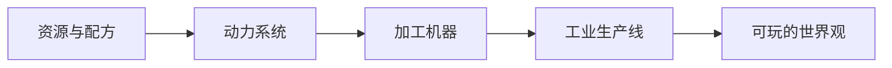

  <h1>🐈 猪咪重工</h1>
  
<strong>Minecraft 工业系统 · 机器 · 工厂 · 世界观</strong>

  
把复杂的生产线，做成玩家愿意理解、愿意操作、也愿意继续研究的世界。

  

    <a href="https://github.com/Zhumi-Heavy-Industries/gtlmodular">GTL Modular</a>
    ·
    <a href="https://github.com/Zhumi-Heavy-Industries/steam-age">Steam Age</a>
    ·
    <a href="https://github.com/Zhumi-Heavy-Industries">组织主页</a>
  

## 🏭 工坊档案

猪咪重工是一个 Minecraft 工业系统与世界观实验室，关注机器之间的关系、生产线的节奏，以及一套系统如何被玩家真正理解。

我们把资源、动力、配方、机器和故事放在同一张设计图里，让每一条自动化线路都像一个小型工厂。

## 🔩 当前项目

<table>
  <tr>
    <td width="50%" valign="top">
      <h3><a href="https://github.com/Zhumi-Heavy-Industries/gtlmodular">GTL Modular</a></h3>
      
GTL 附属模组与独立 NAC 模块，当前主力开发项目。

      
<strong>环境：</strong>Minecraft 1.20.1 · Forge · GTCEu 1.4.4

      
<strong>内容：</strong>纳米芯片组装复合体、猪咪样板总成、地心涌动能量转换枢纽

    </td>
    <td width="50%" valign="top">
      <h3><a href="https://github.com/Zhumi-Heavy-Industries/steam-age">Steam Age</a></h3>
      
第一次工业革命主题的 Minecraft 模组构想。

      
<strong>关键词：</strong>蒸汽机械、压力、效率、煤耗、铁路与维多利亚工业美学

      
<strong>状态：</strong>设计阶段

    </td>
  </tr>
</table>

## 📐 设计原则

- **机器要有理由：** 每个模块都服务于一条可理解的生产链。
- **系统要有反馈：** 压力、效率、资源和故障都应该能被玩家观察到。
- **工业要有气质：** 数值、结构和美术共同组成一个可信的工厂世界。

## 🛠️ 工坊记录

这里会持续记录机械系统、工业流程、配方设计和世界观设定。项目还在搭建中，新的机器和新的生产线会逐步加入。

设计、制造、测试，然后让工厂自己运转起来。

